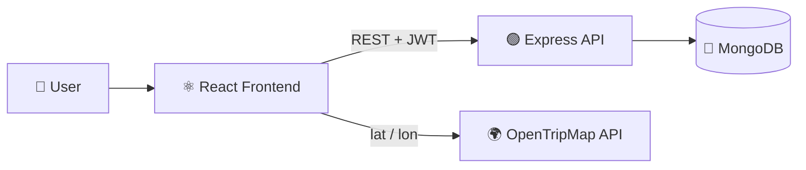

<div align="center">

# 🌿 EcoTrip

### *Travel smarter. Discover the hidden gems around you.*

A MERN-stack travel platform to explore tours and uncover nearby attractions within 5 km of any destination.

<br>


[🐛 Report Bug](https://github.com/vaiii05/EcoTrip/issues) · [💼 LinkedIn](https://www.linkedin.com/in/vaibhavi-rai-2b6110357/)

</div>

---

## 📌 Overview

Most travel sites show only the famous spots. **EcoTrip** lets travellers browse tours and, for any location, instantly surfaces nearby attractions and "hidden gems" within a 5 km radius, complete with photos and descriptions pulled from the OpenTripMap API.

---

## ✨ Features

| | Feature | Description |
|---|---|---|
| 🗺️ | **Nearby Attractions** | Finds up to 10 places within 5 km of a location, with images and descriptions |
| 🧳 | **Tour Explorer** | Browse, search and open detailed tour pages |
| 📅 | **Booking Flow** | Booking form with a thank-you confirmation page |
| ⭐ | **Reviews & Ratings** | Authenticated users can review tours |
| 🔐 | **Authentication** | Register and log in with JWT and bcrypt-hashed passwords |
| 📱 | **Responsive UI** | Image gallery, testimonials, featured tours and newsletter sections |

---

## 🏗️ Architecture



### 🧭 Pages

| Route | Page |
|---|---|
| `/home` | Landing page with featured tours |
| `/tours` | All tours |
| `/tours/:id` | Tour details and booking |
| `/tours/search` | Search results |
| `/login` · `/register` | Authentication |
| `/thank-you` | Booking confirmation |

---

## 🛠️ Tech Stack

| Layer | Technologies |
|---|---|
| **Frontend** | React 18 · React Router 6 · Bootstrap 5 · Reactstrap · react-slick · Masonry gallery · Axios |
| **Backend** | Node.js · Express · Mongoose |
| **Database** | MongoDB |
| **Auth** | JSON Web Tokens · bcrypt |
| **External API** | OpenTripMap |

---

## 🚀 Getting Started

**Prerequisites:** Node.js 18+, a MongoDB database (local or Atlas), and a free [OpenTripMap API key](https://opentripmap.io).

```bash
# 1. Clone the repository
git clone https://github.com/vaiii05/EcoTrip.git
cd EcoTrip/miniproject-master

# 2. Start the backend
cd backend
npm install
npm run dev            # → http://localhost:5000

# 3. Start the frontend (new terminal)
cd frontend
npm install
npm start              # → http://localhost:3000
```

<details>
<summary><b>⚙️ Environment variables</b></summary>

**`backend/.env`**
```env
PORT=5000
MONGO_URI=your_mongodb_connection_string
JWT_SECRET=your_jwt_secret
```

**`frontend/.env`**
```env
REACT_APP_OPENTRIPMAP_API_KEY=your_opentripmap_api_key
```
</details>

---

## 🔌 API

| Method | Endpoint | Description | Auth |
|---|---|---|---|
| `GET` | `/` | Health check | – |
| `POST` | `/api/auth/register` | Create an account | – |
| `POST` | `/api/auth/login` | Sign in and receive a JWT | – |

Review, tour and user controllers and routes are included in `backend/` and are being wired into the server.

---

## 📁 Project Structure

```
EcoTrip/
└── miniproject-master/
    ├── backend/
    │   ├── server.js          # Express app + MongoDB connection
    │   ├── routes/            # auth, review, user, trip routes
    │   ├── controllers/       # review, tour, user logic
    │   ├── models/            # User, Tour, Review, Trip schemas
    │   └── middleware/        # JWT auth
    └── frontend/
        └── src/
            ├── pages/             # Home, Tours, TourDetails, Login, Register...
            ├── components/        # Header, Footer, Booking, Gallery, Testimonials
            ├── NearbyAttraction/  # Nearby attractions feature
            ├── shared/            # TourCard, SearchBar, Newsletter
            └── utlils/            # OpenTripMap client, rating helper
```

---

## 🗺️ Roadmap

- [ ] Mount tour, review and user routes in `server.js`
- [ ] Read the OpenTripMap key from the environment in `NearbyAttractions.jsx`
- [ ] Use device geolocation for a "near me" mode
- [ ] Add eco-friendliness filters and ratings

---

<div align="center">

**Built by [Vaibhavi Rai](https://github.com/vaiii05)**
B.Tech IT (AIML Hons.), Fr. CRIT, Vashi 🎓

[](https://www.linkedin.com/in/vaibhavi-rai-2b6110357/)

⭐ Star this repo if you like it!

</div>
